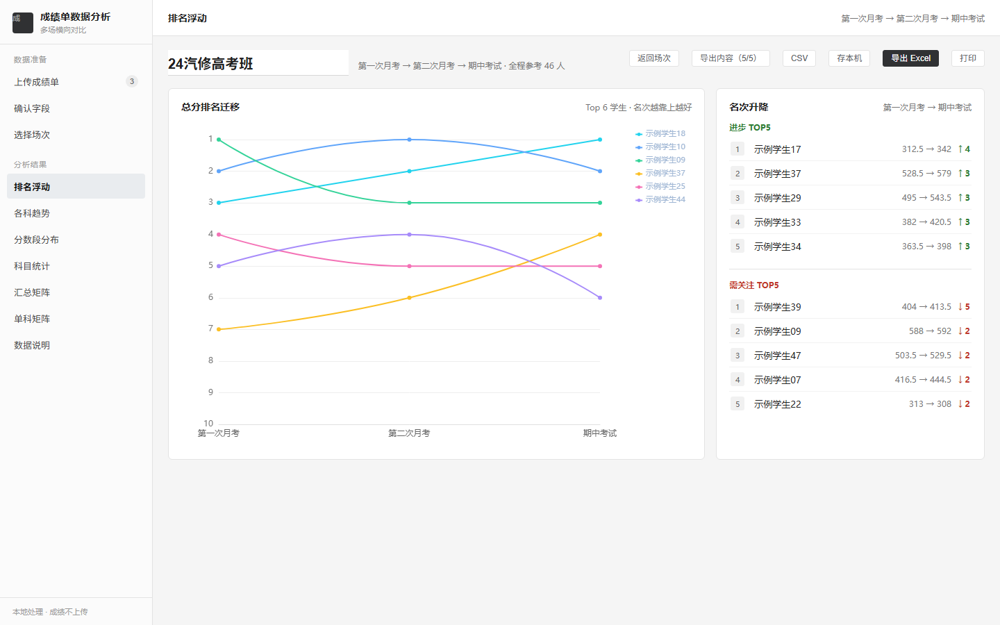

# 成绩对比分析系统（Grade Compare）

把两次考试（如月考、期中）的成绩单变成一张看得懂的对比表：**每个学生、每个科目的名次升降与分数变化**，并导出可直接发给家长/老师的 Excel。

纯前端实现，无后端、无数据库，学生成绩不上传服务器；构建产物为静态文件，可直接部署到 **EdgeOne Pages**。



## 能做什么

- **两份成绩单对比**：基准考试（如月考）× 对比考试（如期中）
- **自动识别表格**：表头行、姓名列、科目列、总分列、原表排名列，识别后可手动调整
- **单科 + 总分双口径**：每个学生每个科目给出基准分数/排名、对比分数/排名、分数变化、名次变化
- **两种排名口径**：并列名次（同分同名次、后续跳号）或顺序名次
- **缺考/转入转出**：只有一场成绩的学生单独标注，不参与名次对比
- **图表**：各科平均分对比、名次升降人数、总分分数段分布
- **导出 Excel**：总览、总分、各科分表、科目统计、说明页，带颜色标记 / 冻结表头 / 筛选
- **导出 CSV**、浏览器打印
- **模板与历史**：字段映射保存为模板，换班级/换考试一键套用；最近分析存本机可恢复
- **示例数据**：`?demo=1` 直接体验完整结果，`?demo=mapping` 查看字段确认页

## 快速开始

```bash
npm ci
npm run dev        # 本地开发 http://localhost:5173
npm run build      # 构建到 dist/
npm run preview    # 预览构建产物 http://localhost:4173
npm test           # 单元测试（分析逻辑 + Excel 导出）
```

可选：浏览器冒烟测试（需先 `npm run preview`，并使用本机 Edge）：

```bash
npm run smoke      # 自动打开示例、点击“导出 Excel”、校验生成的工作表
```

## 使用流程

1. 上传「基准考试」「对比考试」两份成绩单（.xlsx / .xlsm / .csv）
2. 确认字段：考试名称、工作表、表头行、姓名列、科目列、总分列
3. 查看结果：总览图表、汇总表、单科表；可导出 Excel / CSV
4. 需要复用时：保存模板，下次上传同类表格自动按表头名称匹配

### 对成绩单的要求

- 至少包含：姓名列 + 若干科目列
- 总分列可选：没有时按所选科目自动求和
- 自动跳过「最高分 / 最低分 / 平均分 / 及格率 / 优秀率 / 合计」等统计行
- 支持任意科目数量，不限于 5 科

## 本地数据

- 模板、历史记录、分析口径保存在 `localStorage`
- 原始 Excel 只在浏览器内存中解析，不上传
- 清理：浏览器设置中清除本站数据即可

## 技术栈

- Vite 6 + React 19 + TypeScript
- ExcelJS（解析与导出，按需加载）
- ECharts 6（图表，按需加载）

## 目录结构

```
src/
  App.tsx                 三步流程与状态管理
  components/
    UploadStage.tsx       上传 / 示例 / 模板 / 历史
    MappingStage.tsx      字段确认与分析口径
    ResultStage.tsx       结果页（总览 / 汇总 / 单科 / 说明）
    DataTable.tsx         可排序、可搜索表格
    Chart.tsx             ECharts 容器
  lib/
    parse.ts              表格解析、表头识别、学生记录构建
    analyze.ts            排名、升降、统计、分数段（纯函数）
    export.ts             Excel / CSV 导出
    demo.ts               演示数据
    storage.ts            模板 / 历史 / 口径持久化
    format.ts             数值格式化
  types.ts
  styles.css
edgeone.json              EdgeOne Pages 构建与响应头配置
docs/                     项目截图
deliverables/             家长会成品材料（含真实学生数据，默认不入库）
```

## 配套材料

`deliverables/` 内是这套系统生成的实际成品（不提交到 Git）：

- `期中-月考成绩对比分析.xlsx`：月考 vs 期中的完整对比表
- `24汽修高考班_期中家长会.pptx`：21 页家长会课件（含单招 / 对口对比与分数线）
- `升学政策与分数线来源.md`：政策与分数线的核验记录、官方网址

> 这些文件含真实学生姓名与成绩，已加入 `.gitignore`。仓库中只保留合成演示数据。

## 部署

见 [DEPLOY.md](./DEPLOY.md)。最短路径：

```bash
npm i -g edgeone
edgeone login
edgeone pages deploy -n grade-compare
```

## 说明

- 名次变化 = 基准名次 − 对比名次（正数=上升）；分数变化 = 对比分数 − 基准分数
- 分数受试卷难度影响，建议结合名次变化判断进退
- 本工具只做统计，不替代学校正式成绩分析结论

